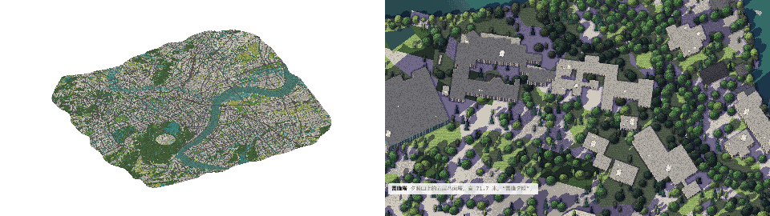

# 像素杭州 · 主城区活地图

一座可以转、可以放大、可以走进去的像素杭州。整座主城区（东经 120.00–120.40，北纬 30.12–30.44，约 1,430 平方公里）是一个悬浮在白底上的立体模型，边缘化成散点溶进白色。画风来自 [pixel-plays](https://github.com/amirmushichge/pixel-plays)（MIT）：五级色阶、左上来的光、紫灰的影子、深度的描边、抖动。44 万栋建筑、每一片水、每一条路都来自开放数据。路名、地名和 24 处地标都能搜，搜到就飞过去，并在图上画出来。



## 运行

需要 Node 18 以上。页面读的烘焙数据（`data/baked/`，约 324 MB）不在仓库里：新克隆的仓库要先按下面"从头构建数据"把它做出来。

```
node serve.mjs
```

然后打开 <http://127.0.0.1:5300/app/>。首次打开约 2 秒出现全景（要加载 5 MB 的全景包）。

没有构建步骤，没有依赖；页面是原生 ES 模块和 WebGL2。只保证 Chrome；手机上可用（单指平移、双指转动与缩放）。

地址后面加 `?ui=off` 只留地图（截图用）。

## 操作

| 动作 | 鼠标键盘 | 触屏 |
|---|---|---|
| 平移 | 左键拖动，或 W A S D / 方向键 | 单指拖动 |
| 旋转、俯仰 | 右键拖动 | 双指一起拖动 |
| 缩放 | 滚轮（以鼠标下面的东西为锚点） | 双指张开（以两指中间的东西为锚点） |
| 回到全景 | R 或"全景"按钮 | "全景"按钮 |
| 正俯视 | M 或"俯视"按钮 | "俯视"按钮 |
| 季节 | 1 2 3 4 或右上角的按钮 | 按钮 |
| 去一处地标 | 点左上角名录里的名字（窄屏先点"地名"）；之后右键拖动是绕着它转 | 同左 |
| 找一个地方 | 左上角的搜索框里写路名、地名；`/` 或 Ctrl+K 把键盘交给它。写一个字出一批候选，上下键选，回车去，Esc 清除。地址后面加 `?find=文三路` 打开就落在那里 | 点搜索框，再点一条候选 |
| 西湖导览 | T 或"西湖导览" | 按钮 |
| 像素大小 | 右上角"像素"按钮，三档 | — |

## 从头构建数据

需要 Python 3.11 以上和约 3 GB 磁盘。原始数据不在仓库里：OpenStreetMap 的浙江提取包、3D-GloBFP 的一块瓦片、Copernicus GLO-30 的一块、ESA WorldCover 的一块（地址见 `docs/DATA-SOURCES.md`），放到 `data/raw/`。

```
python3 -m venv .venv
.venv/bin/pip install -e pipeline          # osmium、shapely、numpy、pyproj、pyshp、tifffile、imagecodecs
PYTHONPATH=pipeline .venv/bin/python -I -m hz.build_all     # 下载之后的一切：提取、合并、地形、地面、树、地标、烘焙，约 12 分钟
```

`--list` 列出每一步，`--from ground` 从某一步起重跑，`--only trees` 只跑一步。`hz/landmarks.py` 是 24 处地标的表（对应的 OSM 要素、模型尺寸、取景距离）。`hz/names.py` 是搜索用的名字索引；俗名、简称记在 `data/curated/aliases.json`，要加一条就在那里添一行，重跑 `--only names`。

## 测试

```
node tools/tests/data-readers.cjs                                                    # 网页端的读取器对着真实烘焙文件核对；名字索引逐列核对，15 个名字各自的第一名
node tools/tests/bake-compare.cjs <上一版烘焙的目录>                                  # 新一版烘焙逐栋、逐棵、逐块对着上一版：位置差不超过半个单位，其余相同
.venv/bin/python -I -m unittest discover -s pipeline/tests -t pipeline/tests          # 数据管线的单元测试
NODE_PATH="$(npm root -g)" node tools/tests/search.cjs                                                    # 按名字找地方：搜索框、候选、飞达、高亮落在路上、手机
NODE_PATH="$(npm root -g)" node tools/tests/shadows.cjs                              # 阴影贴图对着解析答案逐像素比对
NODE_PATH="$(npm root -g)" node tools/tests/smoke.cjs                               # 真实城市的十四个视角
NODE_PATH="$(npm root -g)" node tools/tests/tour.cjs                                 # 24 处地标、四季、缩放阶梯，顺带出验收图
NODE_PATH="$(npm root -g)" node tools/tests/landmark-views.cjs                         # 每处地标的取景：露出来多少像素、在不在中央、是不是自己的颜色
NODE_PATH="$(npm root -g)" node tools/tests/zoom-anchor.cjs                             # 滚轮缩放的锚点：鼠标下面的东西不动
NODE_PATH="$(npm root -g)" node tools/tests/mouse.cjs                                   # 左键拖动平移、右键拖动转视角
NODE_PATH="$(npm root -g)" node tools/tests/mobile.cjs                               # 两种手机的模拟
NODE_PATH="$(npm root -g)" node tools/tests/throughput.cjs --ss 2,4 --out 名字        # 吞吐
NODE_PATH="$(npm root -g)" node tools/tests/roam.cjs --minutes 10                    # 随机漫游十分钟
NODE_PATH="$(npm root -g)" node tools/tests/fidelity.cjs                             # 与原版参照逐像素比（闸门 G1）
NODE_PATH="$(npm root -g)" node tools/tests/frames.cjs <目录>                         # 54 张定死的静帧（时间冻结、界面隐藏），改数据或渲染前后各拍一次
node tools/tests/frames-diff.cjs <改前目录> <改后目录>                                  # 逐像素比这两组静帧
```

浏览器测试各自起一个本地服务器（端口 5390–5399），不要同时跑两个。`fidelity.cjs` 的退出码是 1：它停下来报的就是下面那项已知的例外，其余指标全过。

浏览器测试需要全局安装的 Playwright 和 `/Applications/Google Chrome.app`。

## 文档

- `docs/PLAN.md` 批准的计划；`docs/PROGRESS.md` 进度；`docs/DECISIONS.md` 执行期间的全部取舍。
- `docs/GATES.md` 三道闸门的结果（其中 G1 带着一项未达标，见下）。
- `docs/DATA-REPORT.md` 数据底座：数量、来源、推断清单。`docs/DATA-SOURCES.md` 原始数据与许可。
- `docs/STYLE-GUIDE.md` 这座城是怎么画的。
- `docs/REVIEW/` 验收图：24 处地标各三个侧面（`1-01.png` … `4-05.png`，左边是页面原大的主视角，右边两个是另两个侧面的中间部分；`focus-1.png` … `focus-6.png` 是主视角中间放大两倍的近景）、西湖核心的四季、从全景到断桥的六档缩放、绕雷峰塔一圈、俯视与全景。全尺寸的帧在 `out/review/`。
- `docs/REVIEW-QUEUE.md` 等你定夺的品味问题。

## 数据与许可

- 地图数据 © [OpenStreetMap](https://www.openstreetmap.org/copyright) 贡献者，ODbL：建筑轮廓、道路、铁路、水面、土地利用、地名。
- 楼高和 OSM 没画的建筑轮廓来自 [3D-GloBFP](https://doi.org/10.5281/zenodo.11397014)（Che & Ban 2024，CC BY 4.0），2020 年数据，论文报告在中国的楼高误差约 13 米。
- 地形：Copernicus GLO-30（欧盟哥白尼计划）。土地覆盖：ESA WorldCover 2021（CC BY 4.0）。
- 代码 MIT，保留 pixel-plays 的署名（`LICENSE`）。没有使用 pixel-plays 的音乐。
- 本项目不是 OpenStreetMap 官方产品。

## 已知的限制

- **我没有看过这些画面。** 这个环境里截图只能交给视觉模型转述。画质靠客观比对、自动测试和视觉模型的目检保证；最终的样子需要你看验收图。
- **建筑的颜色直到验收阶段才真正生效**：着色器里读错了一个纹理，之前全城的墙都是同一种灰白。修正之后只复核了 8 张地标图（断桥、保俶塔、雷峰塔、净慈寺、城隍阁、灵隐寺、六和塔、拱宸桥），其余的验收图没有经过看图复核，只过了数字检查。请重点看颜色。经过见 `docs/DECISIONS.md` D048、`docs/PROGRESS.md`。
- **闸门 G1 带着一项未达标**：与原版逐像素比对，背面机位的明暗分布差 2.08%（门槛 2%）。原因在参照版一方（它从这个角度漏出桥拱的下表面）；其余四项指标五个机位全过。见 `docs/GATES.md` 和 `docs/DECISIONS.md` D013、D014。
- **搜索只认 OpenStreetMap 里的名字**：主路搜得到，小区里的小路和人行道大多没有名字；由楼高数据集补出来的楼（87%）没有名字。俗名靠别名表。钱塘江高亮画的是江面的岸，因为 OSM 里沿江的线画得很粗，有十几公里是从陆地上穿过去的。见 `docs/DATA-REPORT.md`"名字"一节、`docs/DECISIONS.md` D062。
- **钱塘江现在是运河的青绿色，不是下面写的土黄色**：江面在 OSM 里没有名字，"名字里有钱塘才是江"的规则对它不生效（D053）。原有的问题，做搜索时发现的，没有动；见 `docs/REVIEW-QUEUE.md` 第 32 条。
- 楼高 3.3% 是推断的；屋顶上的小件、树的位置、车船行人全是按规矩生成的；地标的坐标来自 OSM，模型尺寸一半是公开数字、一半按形制估。清单在 `docs/DATA-REPORT.md`。
- **位置存成了 4 厘米一格的整数**（数据从 1.1 GB 降到 320 MB 的代价）。几何在 2 厘米以内和原来一样，但着色器的颗粒噪声是按位置铺的，所以约 1.5% 的像素会比原来高或低一级明暗，远景多一些、近景少一些；肉眼分不出，逐像素比会看到。见 `docs/DECISIONS.md` D058。
- 3D-GloBFP 给三分之一的轮廓记了两条高度不同的记录，烘焙时每组只留较高的一条（`docs/DATA-REPORT.md`"重复的轮廓"）。
- 全景和城区两档之间没有过渡。桥面不投影。街道没有车道线。Safari、Firefox 和真机手机没有测过。
- 只在这台 Mac Studio（M3 Ultra）的 Chrome 上测过性能：所有图层都开，最差一行 95 分位 7.7 毫秒（4 倍超采样，960 × 540）。其他机器没有数据。
- 源码在公开仓库 <https://github.com/iamshaynez/xiaowenz-map>；烘焙数据、原始数据和页面本身都没有发布。
